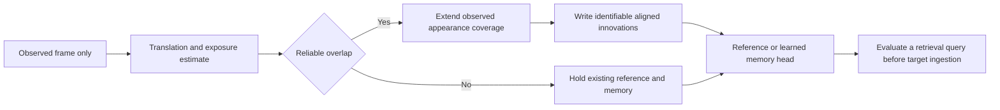
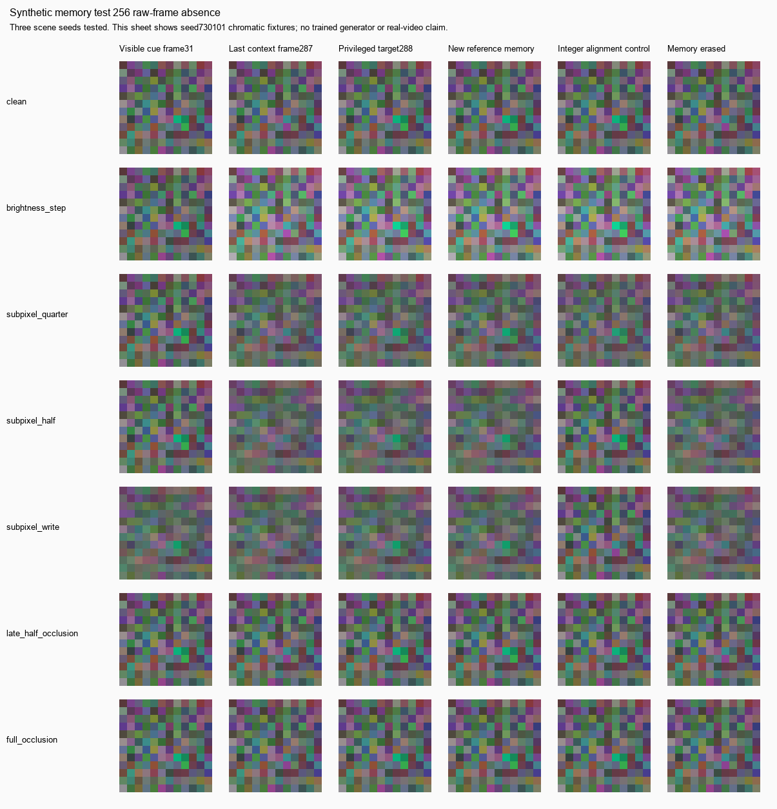

# Observation and memory layer experiment

This experiment addresses the failure identified by the completed Hermes memory studies: unreliable alignment destroys the observations before a learned memory can use them. It adds a causal appearance reference, subpixel registration, exposure normalization and a persistent observed-change memory. It is an isolated research layer; existing models, checkpoints, generated takes and defaults are unchanged.

The registered CPU comparison passed all **42 observable, identifiable cue cases** across three scene seeds and two paired RGB cue families. This establishes explicit image-memory retention under the specified synthetic conditions. It is not trained long-horizon recall, semantic identity, 3 D geometry, a stabilizer or better generated video. The small-occluder negative control still fails, and ambiguous or never-observed information remains unrecoverable.

## What the accumulated evidence says

| Work | Verified outcome | Implication for this layer |
|---|---|---|
| Mixer scaling | The 417x and warmed 886x figures measure a CPU mixing operation, not token savings, a GPU model step or end-to-end video | Compare bounded-window and state-space baselines; report actual hardware and whole-run compute |
| Long-pole correctness | Half-life initialization, exact causal truncation, stateful chunking and filled-slot warmup repair real implementation faults | Use the exact causal stateful path and randomized-head parity tests |
| Blank recall | Clean writes hold 128 frames in a narrow seed 0 probe; learned write gates fail at that budget | Long poles can retain a simple signal; real observation extraction is a separate question |
| Original occlusion comparison | The target gap never occurred in training; the later runner still gave attention a shorter training gap | Every arm must ingest the same long sequence and train against the same retrieval target |
| Signed latent feedback | Approximately 69% of sampled VAE values lie outside [0,1]; clamping was incorrect | Preserve signed feedback and reject incompatible objective/checkpoint resumes |
| K2 rollout trial | Error remained 2.169x frozen persistence, at 4.44x K0 training time | Correctness repair did not establish useful rollout quality |
| Completed K0/K1 campaign | K1 improves K0 in 12/12 diagnostics but beats frozen persistence in 0/12; original ratios 74.97–158.97x;2.706x training cost | Stop treating more rollout steps as a demonstrated improvement |
| Data provenance | Only two source-video names; longest original evaluation repeats one held-out start | Count independent source clips and windows; do not treat repeated batches as independent evidence |
| RGB event pilots | Weighted loss and delayed generalization fail; fixed-batch overfit succeeds | Capacity alone is not the identified bottleneck |
| Chromatic selective writes | Wave and generic SSM succeed on a restricted short signal-separation task | No wave advantage; engineered color separation is not ordinary RGB perception |
| Frozen memory stress | At 64 observed frames, wave 1.6%, SSM0%, explicit latch 100%; brightness/subpixel/occlusion reject all alignment and clear history | Fix observation reliability and preserve valid history before more training |
| Product render audits | Prompt tone and macro depth controls helped individual house chunks; micro geometry did not | These are renderer findings, separate from learned predictor memory |
| Product stabilization | The easy synthetic gain task is matched by a 24-byteEMA; hard phase drift and reported HD motion/detail gates fail | No commercial drift percentage or real-video quality claim follows |

Evidence authorities:

- [Canonical long-horizon analysis](../LONG_HORIZON.md).
- [Completed latent harvest](/Users/slavaz/.hermes/workspaces/video-three-experiments-20261005/training-harvest/REPORT.md).
- [Memory stress report](/Users/slavaz/.hermes/workspaces/video-three-experiments-20261005/memory-stress/REPORT.md).
- [Selective-write result](/Users/slavaz/.hermes/workspaces/video-deep-fix-20261005T004632Z/memory/selective_write/RESULT.md).
- [Signed-latent trial authority](/Users/slavaz/.hermes/diagnostics/hermes-improvement-20261002/gpu/FINAL_HANDOFF.md).
- [Native-HD math-render engineering result](../reports/ENG1_1080.md).
- [House-render findings](/Users/slavaz/.hermes/workspaces/brainsnn/generator_audit/rung2/R2D_VERDICT.md).

Historical reports name two test files that are now missing. The saved-model replay remains reproducible: the independent audit replayed 90 predictions exactly. New tests in this directory are present and runnable; old test-count claims are not substituted for current verification.

The ENG-1 report calls its inputs “real footage,” but its source task and render-preparation notes identify `~/math-reels/dist/e_curve.mp4` and `fib_spiral.mp4` as rendered mathematical reels. They are actual native-HD video files and useful non-interference tests; they do not establish independent natural-scene or client-footage validation. See [input provenance](../reviews/claude_eng1_task.md) and [source-type notes](../reviews/SITE_ASSET_RENDER_PREP.md).

## The next layer



`ObservationMemory.step(frame)` accepts only one observed RGB frame. It estimates bounded translation from a previously observed reference, fits robust gain/offset, reports overlap/confidence and writes only accepted changes. Rejection leaves reference, pose, photometry and historical change memory intact. Unknown pixels have an explicit mask. Fractional writes use a guarded inverse of the observed bilinear sampling operator; an unidentifiable write is held rather than invented.

Photometry is `observed = gain * canonical + offset`. The reference tensor is canonical; default read/forecast RGB is in observed units. `canonical_innovation` is a signed change in the first viewport's coordinates for the model adapter. These values are never clamped to [0,1].

The explicit latch records a historical observed change. It does not know whether an object is currently present. A small foreground cover can look exactly like an object change. **Do not paste its remembered RGB directly into production video.** The learned consumer needs a validated read/visibility policy and a pretrained generative prior; a frozen VAE supplies a codec, not that prior.

## Registered CPU result

The final visible cue is raw frame 31. The hidden interval is `[32,288)`, exactly 256 raw frames. Target 288 is generated for scoring but never ingested. Three held-out **data** seeds 730101/730102/730103 are not three trained initialization seeds. Conditions and cue families are paired on those three underlying scenes, not 72 independent worlds.

| Condition | New layer cue hit | Integer-only ablation cue hit | Unregistered all-time latch cue hit |
|---|---:|---:|---:|
| Clean |1.000|1.000|1.000|
| Brightness step |1.000|1.000|0.333|
| Half-pixel read shift |1.000|0.167|0.167|
| Half-pixel write |1.000|0.000|0.000|
| Late broad occlusion followed by clear observations |1.000|1.000|1.000|

The integer ablation shares the new photometry and all-time latch. It isolates alignment resolution; it is **not** the historical first-four-frame E2 latch. EMA, observed reference, fixed last-context frame, erasure, privileged oracle and wrong-identity/location controls are also retained.

All 42 primary positive cases pass registered memory-component recovery, actual erasure dependence and donor-state replacement. Static brightness-change cases have no false memory. Ambiguous repeating texture and completely hidden writes have zero recovery and are reported as unidentifiable/unobservable. Small transient occluders create false memory in all six negative cases. Target-only disocclusion is an unknown-content negative control, not an observable prediction problem.

`score_memory` compares intact prediction minus the same stream's actual reference-only prediction with the true event delta. It cancels shared background reconstruction error. Full RGB reconstruction, background error, event ROI and unknown-region error remain separate. All target/world/mask information is privileged scorer metadata, never an inference input.

The run contains 72 paired cases and 864 metric rows, takes 12.72s wall/12.72s CPU on one thread, and peaks at 217.6 MB process RSS. This offline runner holds complete clips; retained-state tensor counts do not establish constant process memory.

Authority: [preregistration](receipts/20261013-v2-registered/preregistration.json), [verdict](receipts/20261013-v2-registered/verdict.json), [full metrics](receipts/20261013-v2-registered/metrics.jsonl), [compute/source receipt](receipts/20261013-v2-registered/receipt.json).



## Run locally

```bash
cd /Users/slavaz/crumb-format/experiments/wavefield_video/observation_memory_v2
/Users/slavaz/crumb-format/.venv-standalone/bin/python -B -m unittest -v test_observation test_protocol test_adapters test_train
/Users/slavaz/crumb-format/.venv-standalone/bin/python -B run.py --out receipts/NEW_UNIQUE_RUN
```

The runner refuses to overwrite an output directory, writes its preregistration before evaluation, binds source hashes and checks they did not change during the run. An oracle remains a labeled control.

## Native model integration

`adapters.py` extracts signed innovations from observed frames, then connects them to the actual native `VideoPredictor` wave, diagonal SSM and bounded-window attention operators. The heads receive neither the explicit RGB latch nor target, world, event-coordinate or visibility labels. Decode uses the recipient's own observed reference and estimated transform. Wave and SSM retain autograd state across true 32-frame chunks; all arms receive the same input sequence. Attention retains the last 32 innovations and invokes its native model only for the final query. Its timing is therefore final-query retrieval cost, not processing every frame of a video.

All **46 contract tests pass**, including native mixer gradients/parameter updates, chunk state, signed decode, true partial chunks, future-suffix poisoning, balanced training fixtures, actual state interventions and checkpoint/prediction replay. Run them with:

```bash
/Users/slavaz/crumb-format/.venv-standalone/bin/python -B -m unittest -v test_observation test_protocol test_adapters test_train
```

The final explicit CPU smoke completed one optimizer update for each head, seed 0, with a 40-frame input and an 8-frame hidden interval. Its eight training fixtures cover every condition×cue-family cell; evaluation uses eight held-out positive fixtures and two no-event fixtures per head. Mixer parameters changed in all three heads; all three held-out cue recovery scores remain zero and their descriptive recall gates fail. This validates the training connection only. Wall time was 3.92 s. Parameter counts are 3,133 / 4,227 / 4,147, so equal dimensions and updates do not mean equal resources. Wave uses the clean-write variant; stock SSM/attention retain biases and spatial embeddings. This is another declared comparison confound.

Authority: [final smoke preregistration](receipts/20261013-native-training-smoke-final/preregistration.json), [final training receipt and failed cue scores](receipts/20261013-native-training-smoke-final/receipt.json). Earlier smoke receipts are preserved; the initial runner's coupled cue families and output-zeroing control were replaced before staging the full campaign.

### Numerical limits retained

An independent audit exposed native wave FFT intermediate-output sensitivity on sparse, nearly blank prefixes. Poisoning later inputs changed an earlier dense prefix prediction by roughly 0.01–0.11 across initialization probes, despite the mathematically causal truncated kernel. Tiny roundoff can be amplified by normalization near zero. This is not evidence that all FFT paths are causally sound, and it is not repaired by relaxing a test tolerance.

Native frame recurrence avoids giving a prefix computation any future frame, so public per-frame predictions use that path. The final-only chunk path is restricted to one layer. Multilayer chunk/frame disagreement was also observed: approximately 0.0066 prediction / 0.0248 state at two layers, and 1.727 / 35.07 at four layers. The adapter rejects those configurations. Partial differentiable chunks with native gradient checkpointing are also rejected because checkpoint recomputation otherwise reads the restored time length. Full-window checkpointing remains tested. Canonical source is unchanged; these are explicit scope restrictions, not a general numerical repair.

Authority: [negative diagnostic receipt](receipts/20261013-native-numerics/receipt.json) and [reproducible probe](receipts/20261013-native-numerics/diagnostic.py). Five initialization probes are diagnostic seeds, not trained models.

## Staged learned test

`train.py` stages the next integration campaign: a 256-raw-frame hidden interval, 288 observed input frames for every arm, initialization seeds 0/1/2, disjoint balanced training/held-out fixture seeds, the same cached observations and AdamW optimizer, and 1,000 updates per arm within a shared 3,600-second cooperative deadline. An incomplete campaign is recorded as partial and non-comparable. Deadline checks occur between updates/evaluation examples; preparation is not interruptible, so the scheduler wrapper must also provide an outer hard cap. CUDA is required unless `--smoke` is explicitly requested; an unavailable GPU causes refusal before creating output.

Evaluation zeroes actual recurrent tensors or attention state immediately after the cue, then ingests the same recipient hidden tail. Donor evaluation swaps actual state from the opposite observed cue at the same boundary, retaining recipient reference/pose. Zero decoded event output is separately labeled reference-only. Per-example metrics, latch/reference/EMA/frozen/oracle controls, frozen descriptive thresholds, state payload, CUDA peaks and source/checkpoint/prediction hashes are saved. Tensor counts exclude optimizer/activation/workspace overhead; full BPTT is not constant-memory training.

The GPU command, from a verified isolated copy under the existing conductor, is:

```bash
python -B train.py --updates 1000 --seconds 3600 --out receipts/NEW_UNIQUE_GPU_RUN
```

[Staged launch plan](GPU_TEST_PLAN.json) fixes the input/seed/budget requirements and existing-conductor boundary. A local source bundle and hash manifest are prepared at `~/.hermes/diagnostics/mary-video-20261013/staged-source-pack-final.json`; they have not been uploaded or queued.

This campaign tests whether learned heads can use the repaired observation stream. It is not a generator benchmark or a promotion gate. Equal steps are not matched compute, and a plain 32-frame attention window cannot retain a cue 256 frames earlier. Sink/reference attention, matched write/bias variants and measured resource comparisons remain necessary before an architectural advantage claim. The actual registered engineering controls are the stronger current evidence for explicit memory.

## Follow-up gates

1. Completed locally: connect the same observed-only signed features to the existing wave, generic diagonal SSM and bounded-window attention heads, and exercise native backward/parameter updates in a tiny CPU compatibility smoke. This is integration success, not learned retrieval success.
2. Run the identical 256-frame dependency across initialization seeds 0/1/2 on healthy, exclusively owned GPU hardware. The attention arm sees the entire sequence under its bounded state; its training gap is never shortened. Keep explicit latch/reference controls. Report real parameter counts, state, measured wall time and completed updates rather than claiming equal compute from equal steps.
3. Add factorized attention and a sink-plus-window/reference baseline before claiming an advantage over deployed linear models. The local `SSMLite` is not Mamba; [Mamba2's primary paper](https://arxiv.org/abs/2405.21060) describes a different selective state-space family.
4. Validate a frozen pretrained video VAE through future-suffix poisoning before latent-context use. Log raw-frame gap separately from latent-step gap. Decode held-out rollouts and report first collapse, motion, unknown regions and fixed frozen-last-context error.
5. Run a genuinely blind native 720p/1080p real-clip acceptance test with detail, motion and temporal quality gates. A resized image probe or this synthetic grid does not satisfy it. Use owned/authorized footage; outside-client clips and commercial demand remain unavailable.

The configured 4090 SSH endpoint timed out on October 13. No job was submitted, controller started, power changed or paused lane resumed. The GPU campaign is staged, unrun. Code correctness and this engineering result do not promote a model or generated clip.

## Hermes collaboration and commercial order

The native Hermes Video profile provided a read-only critique through its local Qwen model, with zero tool calls. Its caution about synthetic versus real evidence and nondestructive rejection was retained. Its assertion that the proposed inference API contains oracle inputs was incorrect and rejected; the actual API and poisoning tests are the authority. Review receipt is private at `~/.hermes/diagnostics/mary-video-20261013/hermes-review-receipt.json`.

Mary's letter prioritizes a frozen 72-hour real-clip rescue challenge and independent human review over further engine tuning. That is a separate product-validation gate: collect authorized stranger clips, process blind at native resolution, record refusals/quality failures/payments, and stop if no one pays for the defined service. No outreach, billing, public claim, portfolio migration or publication was performed here. The research layer remains isolated so those decisions can be made without changing the existing product.

[Prepared real-clip and service-test gate](REAL_CLIP_GATE.md) records what must be frozen and measured before running those tests; neither is marked complete.

The 417x token-saving claim, long-coherence claims from untrained weights, synthetic drift-removal percentages and superiority over deployed windowed/SSM models remain unsupported. The strongest current claim is narrower: **the new observed-reference control survives the registered synthetic nuisances and preserves a cue that the old observation path could discard.**
